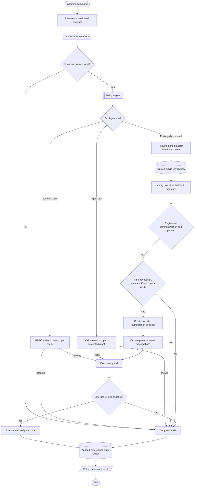

# Nova Umbrella Master Governance — Architecture Specification

## Authority model

| Principal | Authentication | Allowed authority |
|---|---|---|
| Public user | Individual account credentials; optional user MFA | Own profile, entitled features, owned/assigned resources |
| Premium user | Individual account plus subscription entitlement | Same account boundary with premium feature/usage entitlements |
| Agent | Registered machine identity plus short-lived delegated grant | Explicit task ID, resource scope, and permission list only |
| Operator | Strong account authentication and operator role | Monitoring and explicitly approved maintenance |
| Master administrator | Pinned immutable account ID, strong MFA, KMS-backed Ed25519 signature | Registered privileged command/action set, bounded scope and expiry |

The human-readable administrator name is descriptive only. Authorization uses a provisioned immutable account ID and registered public key. No request field, agent, provider, operator, or user-editable role can create or replace master authority.

## Two authorization tiers

1. **Standard user tier:** password hashing, account/session lifecycle, token hashing, session expiry and atomic rotation, RBAC, resource scopes, and subscription entitlements kept separate from administrative privileges.
2. **Master tier:** KMS/HSM signing, server-side Ed25519 verification, fixed command/action-to-permission mapping, MFA step-up, bounded expiry, command-ID and nonce replay protection, key revocation, and append-only audit.

Agents receive delegated grants only after policy approval. Grants bind agent ID, task ID, permissions, and expiry. They do not contain master authority and cannot be used for another task.

## Privileged command envelope

The canonical signed payload contains:
- command ID and administrator immutable ID
- registered key ID and Ed25519 algorithm
- command type, target, action, and permission scope
- issue time, expiry time, and one-time nonce

The signature is calculated over deterministic canonical JSON with sorted keys and compact separators. The signature itself is excluded from the signed payload. The KMS/HSM performs signing; the private key is never exported to application code, source control, browser/mobile bundles, environment variables, or ordinary database rows.

Example shape (illustrative only):
```json
{
  "command_id": "unique-command-id",
  "administrator_id": "pinned-master-account-id",
  "key_id": "master-signing-key-2026-01",
  "command": "AGENT_OVERRIDE",
  "target": "apex",
  "action": "CANCEL_EXECUTION",
  "scope": "task:cancel",
  "issued_at": 1800000000,
  "expires_at": 1800000120,
  "nonce": "one-time-random-value",
  "algorithm": "Ed25519",
  "signature": "base64-signature"
}
```

The gateway derives the required permission from a server-maintained command/action registry. It does not trust a caller-supplied permission or scope. Unknown command/action pairs are denied.

## Master authorization flow



## Master override capability catalogue

- Stop/suspend an agent; cancel a task; revoke agent grants.
- Change governance policy; approve exceptional recovery.
- Modify protected state after validation and precondition checks.
- Rotate signing keys through a dedicated atomic rotation procedure.
- Restore services through an approved recovery procedure.
- Review agent activity and protected audit history.

Emergency stop blocks ordinary execution. Releasing it is itself a privileged signed command. Audit history cannot be deleted or rewritten through an override.

## Mandatory safeguards

1. MFA plus KMS-backed asymmetric signature for every master action.
2. Key rotation with historical verification and atomic retirement of the old key.
3. Recovery ceremony with explicit identity proofing, audit, and revocation; never silently mint a second master.
4. Immediate revocation of keys, sessions, and delegated grants after compromise.
5. Separation of duties and independent validation for destructive, financial, and security-sensitive actions.
6. Hash-chained, KMS-signed, append-only audit events with independent backups and reconciliation.
7. Fail closed when authentication, policy, key, signature, replay, or audit controls are unavailable.

## Code map

- `authentication/`: account password and session lifecycle; administrator TOTP.
- `authorization/`: RBAC, permission catalogue, command/action privilege mapping, policy engine.
- `cryptography/`: Ed25519 verification, trusted public-key registry, revocation, canonical command signing, key rotation.
- `master_control/`: privileged command gateway, override execution, emergency stop, replay nonce storage.
- `audit/`: hash chain, optional mandatory KMS signature, integrity verification.
- `enforcement/`: standard-user/agent execution guard and delegated credentials.

## Deployment conditions

This specification and the code modules are not sufficient on their own to secure every runtime path. The production API, Supreme Orchestrator, agents, provider adapters, integrations, scheduled jobs, and workers must all receive a trusted authenticated principal and call the execution guard before performing work. The existing chat endpoint currently needs this authenticated-principal and guard integration before it can be considered protected.

No production enablement until persistent adapters, KMS/HSM, MFA secret/counter store, atomic replay store, key lifecycle, emergency-stop latch, audit signing/backup, and full integration tests are deployed and reviewed.
